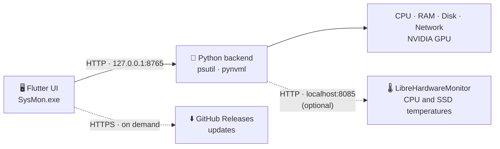

<div align="center">

# 🖥️ SysMon

**یک مانیتور سیستم سبک و لحظه‌ای برای ویندوز — CPU، GPU، RAM، شبکه و دما در یک داشبورد تمیز.**

[](https://github.com/pourad/Sysmon/releases/latest)


[قابلیت‌ها](#features) · [چطور کار می‌کنه](#how) · [نصب](#install) · [تست اینترنت](#nettest) · [دما](#temps) · [آپدیت](#updates) · [ساخت](#build) · [رفع مشکل](#trouble)

[English](README.md) · **فارسی**

</div>

---

## 🔴 نکته‌ی مهم

می‌تونی از این برنامه استفاده کنی یا تغییرش بدی، به شرطی که **منبع رو ذکر کنی**. کپی کردن بدون ذکر منبع ممکنه **پیامدهای قانونی** داشته باشه.

اگه پروژه رو دوست داشتی، می‌تونی بهش **ستاره** ⭐️ بدی.

## 📖 معرفی

SysMon <sub>(قبلاً با اسم System Monitor شناخته می‌شد)</sub> نشون می‌ده کامپیوترت **همین الان** چیکار می‌کنه و وقتی یه چیزی خراب می‌شه بهت هشدار می‌ده.

اول یک اسکریپت کوچیک Python/Tkinter بود و بعد با **Flutter** دوباره ساخته شد، پس ظاهرش رو می‌شه آزادانه طراحی کرد. بخشی که سخت‌افزار رو می‌خونه توی **Python** مونده (`psutil` و `pynvml`)، چون خود Flutter نمی‌تونه شمارنده‌های CPU و GPU رو بخونه.

**چی گیرت میاد**

- نمودار و گیج لحظه‌ای برای CPU، GPU، RAM و شبکه
- ردیابی دمای **CPU، GPU و SSD** با کمترین / میانگین / بیشترین
- یک **تست کیفیت اینترنت** (سرعت، تأخیر، jitter، تأخیر زیر بار، packet loss) به روش تست سرعت Cloudflare
- هشدار وقتی مصرف از حد تعیین‌شده رد بشه، به‌علاوه‌ی یک فایل لاگ برای بررسی بعدی
- نظارت روی پروسه که می‌گه یک برنامه بسته شده یا کرش کرده
- تم تیره و روشن، و نوار بالای پنجره که با رنگ برنامه هماهنگه
- آپدیت با یک کلیک مستقیم از GitHub Releases

---

<a id="features"></a>

## ✨ قابلیت‌ها

### صفحه‌ها

| صفحه | چی نشون می‌ده |
|---|---|
| **Dashboard** | نمودار لحظه‌ای CPU / GPU / RAM با مقدار فعلی، سه گیج، آمار سریع (فرکانس CPU، دمای GPU، RAM مصرفی، سرعت نوشتن دیسک) و نظارت روی پروسه |
| **CPU** | گیج مصرف، میانگین ۱ دقیقه، فرکانس، هسته‌های منطقی و فیزیکی، تعداد پروسه‌ها، نوار مصرف هر هسته، نمودار تاریخچه |
| **GPU** | مصرف، دما، حافظه‌ی مصرفی / کل، سرعت فن، نمودار تاریخچه (کارت‌های NVIDIA) |
| **RAM** | مصرف، حافظه‌ی کل / مصرفی / آزاد، swap، نمودار تاریخچه و پروسه‌هایی که بیشترین حافظه رو می‌خورن |
| **Network** | سرعت دانلود و آپلود (Mbps)، تاریخچه، کل داده‌ی منتقل‌شده، کارت شبکه‌ی فعال، شمارنده‌ی بسته‌ها، و **تست کیفیت اینترنت** |
| **Temps** | دمای CPU، GPU و SSD با **MIN / AVG / MAX**، وضعیت رنگی، نمودار تاریخچه و دکمه‌ی ریست |
| **Log** | لاگ زنده‌ی رویدادها (هشدارها، اخطارها، کرش‌ها). باز کردن فایل لاگ یا پاک کردن نمایش |
| **Settings** | آستانه‌ی هشدار، آستانه‌ی لاگ، cooldown، فاصله‌ی به‌روزرسانی، برگشت به پیش‌فرض و بررسی آپدیت |

### ویژگی‌های مهم

- **هشدار هوشمند** — وقتی CPU، RAM یا GPU به سطح بحرانی برسه یک بنر میاد. یک cooldown جلوی هشدارهای پشت‌سرهم رو می‌گیره.
- **نظارت روی پروسه** — اسم پروسه یا PID رو بنویس. اگه ناپدید بشه، SysMon هشدار کرش نشون می‌ده و ثبتش می‌کنه.
- **مقدارهای رنگی** — سبز، زرد و قرمز همه‌جا (گیج‌ها، نوارها، دماها) از آستانه‌های تو پیروی می‌کنن.
- **تم تیره / روشن** — با دکمه‌ی پایین منوی کناری عوض می‌شه. نوار بالای پنجره هم با تم عوض می‌شه.
- **بنر آپدیت** — چند ثانیه بعد از باز شدن، SysMon بی‌صدا GitHub رو چک می‌کنه و اگه نسخه‌ی جدید باشه بنر نشون می‌ده.
- **برگشت به پیش‌فرض** — با پنجره‌ی تأیید، تا تنظیمات به‌اشتباه ریست نشه.
- **نشانگر آفلاین** — داشبورد `● Live` یا `● Offline` رو نشون می‌ده تا همیشه بدونی داده می‌رسه یا نه.

---

<a id="how"></a>

## ⚙️ چطور کار می‌کنه

SysMon دو برنامه است که با یک اتصال محلی با هم حرف می‌زنن. به‌جز بررسی اختیاری آپدیت و تست اینترنت، چیزی به اینترنت فرستاده نمی‌شه.



| تیکه | زبان | کار |
|---|---|---|
| `backend/monitor_backend.py` و `backend/netquality.py` | پایتون | فقط داده می‌خونه (CPU، GPU، RAM، شبکه، دما) و تست اینترنت رو انجام می‌ده. **هیچ رابط گرافیکی نداره.** |
| `lib/` | فلاتر | همه‌ی ظاهر و دکمه‌ها. داده رو از بک‌اند می‌گیره و نشون می‌ده. |

**چرخه**

1. هر ثانیه (قابل تنظیم) رابط کاربری از بک‌اند عددهای تازه می‌خواد.
2. بک‌اند سخت‌افزار رو می‌خونه و با یک سند JSON جواب می‌ده.
3. رابط نمودارها رو آپدیت می‌کنه، آستانه‌های هشدار رو چک می‌کنه و رویدادها رو ثبت می‌کنه.
4. رویدادهای مهم از طریق بک‌اند توی فایل لاگ هم نوشته می‌شن.

توی نسخه‌ی نصب‌شده خودت هیچ‌وقت بک‌اند رو اجرا نمی‌کنی — برنامه خودش اجراش می‌کنه و بک‌اند با بسته شدن برنامه خودش بسته می‌شه.

<details>
<summary><b>API بک‌اند</b> (برای توسعه‌دهنده‌ها)</summary>

بک‌اند روی `127.0.0.1:8765` گوش می‌ده.

| Method | مسیر | کار |
|---|---|---|
| `GET` | `/stats` | همه‌ی آمار سیستم به شکل JSON |
| `GET` | `/top-procs` | شش پروسه‌ای که بیشترین حافظه رو مصرف می‌کنن |
| `GET` | `/health` | بررسی ساده‌ی «روشنه یا نه» |
| `POST` | `/watch` | شروع نظارت روی یک پروسه — بدنه `{"query": "chrome"}` یا یک PID |
| `POST` | `/unwatch` | توقف نظارت |
| `POST` | `/log` | اضافه کردن یک خط به فایل لاگ — بدنه `{"msg": "..."}` |
| `POST` | `/open-log` | باز کردن فایل لاگ با برنامه‌ی پیش‌فرض |
| `POST` | `/nettest/start` | شروع تست کیفیت اینترنت — بدنه `{"mode": "quick"}` یا `"full"` |
| `POST` | `/nettest/cancel` | لغو تست در حال اجرا |
| `GET` | `/nettest/status` | پیشرفت، مقدارهای لحظه‌ای و نتیجه‌ی نهایی تست |

</details>

---

<a id="nettest"></a>

## 🌐 تست کیفیت اینترنت

توی صفحه‌ی **Network** روی **Start test** بزن تا اتصال واقعی‌ات با همون روش [تست سرعت Cloudflare](https://speed.cloudflare.com) سنجیده بشه:

| معیار | چطور اندازه‌گیری می‌شه |
|---|---|
| **Download / Upload** | فایل‌هایی با اندازه‌ی افزایشی از سرور Cloudflare؛ نتیجه صدک ۹۰ام سرعت درخواست‌هاست، با کم کردن زمان پردازش خود سرور |
| **Latency / Jitter** | ۲۰ درخواست خیلی کوچیک؛ latency میانه‌ی زمان تا اولین بایت و jitter میانگین اختلاف نمونه‌های پشت‌سرهمه |
| **Loaded latency** | تأخیر *در حین* دانلود و آپلود — bufferbloat رو نشون می‌ده، یعنی دلیل اصلی لگ وقتی یکی دیگه از خط استفاده می‌کنه |
| **UDP loss** | ۵۰ تا ۲۰۰ پرس‌وجوی DNS روی UDP به 1.1.1.1 (جایگزینی برای تست loss مبتنی بر WebRTC که Cloudflare داره) |

نتیجه‌ها به امتیاز تبدیل می‌شن — **Streaming، Gaming، Video calls، Web browsing** — از *Bad* تا *Great*، و هر امتیاز می‌گه کدوم معیار محدودش کرده.

- **Quick** (پیش‌فرض): حدود ۲۵ ثانیه و تا حدود ۱۰۰ مگابایت؛ تا حدود ۳۰۰ Mbps دقیقه.
- **Full**: کل مسیر افزایشی Cloudflare (فایل‌ها تا ۲۵۰ مگابایت) برای خطوط خیلی سریع؛ ممکنه تا حدود ۱ گیگابایت مصرف کنه.
- تست هیچ‌وقت خودش شروع نمی‌شه و هر لحظه قابل لغو است.
- امتیازها از آستانه‌های خود SysMon استفاده می‌کنن (`compute_scores` توی `backend/netquality.py`)؛ تخمینی‌ان و امتیاز رسمی Cloudflare نیستن.
- تست مستقیم وصل می‌شه (پروکسی سیستم رو نمی‌بینه)، پس خط واقعی تو رو می‌سنجه.

---

<a id="temps"></a>

## 🌡️ دما

ویندوز دسترسی مستقیم به سنسورهای CPU و SSD رو به برنامه‌های معمولی نمی‌ده، برای همین SysMon دما رو از بهترین منبع موجود می‌خونه:

| قطعه | منبع | نیاز به نرم‌افزار اضافه؟ |
|---|---|---|
| **GPU** | درایور NVIDIA (NVML) با `pynvml` | نه |
| **CPU** و **SSD** | وب‌سرور [LibreHardwareMonitor](https://github.com/LibreHardwareMonitor/LibreHardwareMonitor) | بله — همراه نصب‌کننده هست |
| هر قطعه (لینوکس) | سنسورهای `psutil` | نه |

**خوبه بدونی**

- خوندن دمای CPU به دسترسی **Administrator** نیاز داره، پس برنامه‌ی نصب‌شده هر بار که باز می‌شه یک تأیید ویندوز می‌خواد.
- اگه سنسوری در دسترس نباشه، کارتش `N/A` نشون می‌ده و صفحه توضیح می‌ده چطور فعالش کنی.
- اگه چند SSD داری، داغ‌ترینشون نشون داده می‌شه.
- **MIN / AVG / MAX** از لحظه‌ی باز شدن برنامه (یا آخرین ریست) حساب می‌شن.
- حد رنگ‌ها (هشدار / بحرانی) رو می‌شه توی `lib/config.dart` ← `kTempLimits` عوض کرد.

| قطعه | هشدار | بحرانی |
|---|---|---|
| CPU | 75 °C | 90 °C |
| GPU | 75 °C | 85 °C |
| SSD | 55 °C | 70 °C |

---

## 🔔 هشدار و لاگ

**آستانه‌های پیش‌فرض** (همه توی **Settings** قابل تغییرن):

| تنظیم | پیش‌فرض |
|---|---|
| هشدار / بحرانی CPU | 70 % / 85 % |
| هشدار / بحرانی RAM | 70 % / 85 % |
| هشدار / بحرانی GPU | 70 % / 85 % |
| نوشتن توی لاگ وقتی CPU یا GPU بالاتر از | 80 % |
| cooldown هشدار | 30 ثانیه |
| فاصله‌ی به‌روزرسانی | 1 ثانیه |

**فایل لاگ**

- نسخه‌ی نصب‌شده: `%LOCALAPPDATA%\SysMon\monitor_log.txt`
- اجرا از سورس: `monitor_log.txt` کنار `monitor_backend.py`

خط‌های لاگ برچسب دارن تا جستجوشون راحت باشه:

| برچسب | معنی |
|---|---|
| `[INFO]` | شروع، توقف، ابزارهای همراه |
| `[ALERT]` | از آستانه‌ی بحرانی رد شده |
| `[PRESSURE]` | مصرف یا دمای GPU بالاتر از سطح لاگ مونده |
| `[WATCH]` | نظارت روی پروسه شروع یا تمام شد |
| `[CRASH]` | یک پروسه‌ی تحت نظارت بسته شد |
| `[SETTINGS]` | تنظیمات اعمال یا ریست شد |

> تنظیمات و تم انتخاب‌شده تا وقتی برنامه بازه می‌مونن. بعد از ری‌استارت به پیش‌فرض برمی‌گردن.

---

<a id="install"></a>

## 📥 نصب

### برای کاربرها

1. صفحه‌ی [**Releases**](https://github.com/pourad/Sysmon/releases/latest) رو باز کن.
2. فایل **`SysMon-Setup.exe`** رو دانلود و اجرا کن.
3. **SysMon** رو از Start Menu یا میان‌بر دسکتاپ باز کن.
4. تأیید ویندوز (Administrator) رو قبول کن تا دمای CPU و SSD خونده بشه.

پایتون، ترمینال و هیچ دانلود دیگه‌ای لازم نیست.

> ممکنه Windows SmartScreen هشدار «Unknown publisher» بده، چون نصب‌کننده امضای دیجیتال نداره. **More info ← Run anyway** رو بزن.

### پیش‌نیازها

- ویندوز ۱۰ یا ۱۱ (۶۴ بیتی)
- کارت NVIDIA اختیاریه — فقط مصرف و دمای GPU رو فعال می‌کنه

---

<a id="updates"></a>

## 🔄 آپدیت خودکار

**Settings ← Updates ← Check for updates** رو باز کن.

1. SysMon آخرین Release همین ریپازیتوری رو از GitHub می‌پرسه.
2. اگه نسخه جدیدتر بود، توضیحات Release رو می‌بینی.
3. **Download & install** نصب‌کننده رو با نوار پیشرفت دانلود می‌کنه.
4. SysMon اندازه‌ی فایل (و اگه GitHub بده، checksum از نوع SHA-256) رو چک می‌کنه و بعد نصب‌کننده رو اجرا می‌کنه.
5. نصب‌کننده SysMon رو می‌بنده، فایل‌ها رو جایگزین می‌کنه و نسخه‌ی جدید رو باز می‌کنه.

SysMon چند ثانیه بعد از شروع هم بی‌صدا چک می‌کنه. اگه نسخه‌ی جدید باشه یک بنر آبی بالای برنامه میاد، کنار **Settings** یک نقطه می‌افته و دکمه‌ی **Update** کارت Updates رو باز می‌کنه.

فقط فایل‌های همین ریپازیتوری پذیرفته می‌شن.

<details>
<summary><b>منتشر کردن آپدیت</b> (برای نگهدارنده‌ی پروژه)</summary>

1. شماره‌ی نسخه رو توی سه جا بالا ببر: `kAppVersion` (`lib/config.dart`)، `version:` (`pubspec.yaml`) و `AppVersion` (`installer.iss`).
2. `build_release.bat` رو اجرا کن. این اسکریپت با Inno Setup هم `SysMon-Setup.exe` رو می‌سازه (اگه Inno Setup رو پیدا کنه؛ وگرنه `installer.iss` رو دستی Compile کن).
3. توی GitHub بزن **Releases ← Draft a new release**.
4. یک tag مثل `v1.1.0` بساز (باید از قبلی بزرگ‌تر باشه).
5. `SysMon-Setup.exe` رو پیوست کن و تغییرات رو بنویس — کاربرها همین متن رو توی برنامه می‌بینن (بدون فرمت و ایموجی).
6. **Pre-release** رو خالی بذار و **Publish release** رو بزن.

`AppId` توی `installer.iss` رو هیچ‌وقت عوض نکن؛ همونه که اجازه می‌ده نسخه‌ی جدید جای قبلی نصب بشه.

</details>

---

<a id="build"></a>

## 🛠️ ساخت از سورس

<details open>
<summary><b>اجرا در حالت توسعه</b></summary>

**پیش‌نیازها:** [Flutter SDK](https://docs.flutter.dev/get-started/install) (با Visual Studio و گزینه‌ی «Desktop development with C++») و Python 3.

```bash
git clone https://github.com/pourad/Sysmon.git
cd Sysmon

# 1) بک‌اند — این ترمینال باز بمونه
cd backend
pip install psutil pynvml
python monitor_backend.py

# 2) رابط — توی ترمینال دوم، از ریشه‌ی پروژه
flutter pub get
flutter run -d windows
```

نکته‌ها:

- اگه `pip` شناخته نشد، به‌جاش `python -m pip install psutil pynvml` بزن.
- توی حالت توسعه (`flutter run`) برنامه بک‌اند رو خودکار اجرا نمی‌کنه؛ بالای داشبورد `● Offline` می‌بینی تا بک‌اند رو دستی اجرا کنی.
- برای دمای CPU و SSD، بک‌اند رو از یک cmd با **Administrator** اجرا کن و LibreHardwareMonitor رو با Administrator باز کن و **Options ← Remote Web Server ← Run** رو بزن (یا پوشه‌ی `lhm` رو بذار تا بک‌اند خودش اجراش کنه).
- اگه `windows\runner\runner.exe.manifest` روی `requireAdministrator` تنظیم شده، `flutter run` هم باید توی ترمینال Administrator باشه.
- موقع کار، با `r` توی ترمینال فلاتر (یا ذخیره کردن فایل توی VS Code) تغییرات ظاهر رو فوری با **Hot Reload** می‌بینی.

</details>

<details>
<summary><b>ساخت نصب‌کننده</b></summary>

1. (اختیاری) LibreHardwareMonitor رو توی پوشه‌ای به اسم `lhm` کنار `pubspec.yaml` بذار، با فایل `LibreHardwareMonitor.config` که وب‌سرور رو روشن می‌کنه.
2. `build_release.bat` رو اجرا کن — بک‌اند رو با PyInstaller بسته‌بندی می‌کنه، برنامه‌ی فلاتر رو می‌سازه، همه‌چیز رو توی `build\windows\x64\runner\Release` جمع می‌کنه و (اگه Inno Setup نصب باشه) نصب‌کننده رو می‌سازه.
3. اگه نصب‌کننده ساخته نشد، `installer.iss` رو توی [Inno Setup](https://jrsoftware.org/isinfo.php) باز کن و **Compile** رو بزن. نتیجه `Output\SysMon-Setup.exe` است.

راهنمای کامل، از جمله manifest مربوط به Administrator، توی [`BUILD.md`](BUILD.md) هست.

</details>

---

## 🗂️ نقشه‌ی فایل‌ها

```
sysmon/
├── backend/
│   ├── monitor_backend.py      خوندن سخت‌افزار + سرور HTTP محلی (بدون رابط گرافیکی)
│   └── netquality.py           موتور تست کیفیت اینترنت (به روش Cloudflare)
├── lib/
│   ├── main.dart               شروع برنامه، منوی کناری، بنرها
│   ├── config.dart             رنگ‌ها، استایل متن‌ها، پیش‌فرض‌ها، نسخه، ریپازیتوری
│   ├── controller.dart         منطق: دریافت داده، هشدارها، لاگ، نظارت روی پروسه (بدون ظاهر)
│   ├── stats.dart              مدل داده (JSON ← شیء Dart)
│   ├── api.dart                صحبت با بک‌اند
│   ├── temp_tracker.dart       ردیابی دما و min / avg / max
│   ├── net_quality.dart        کنترلر تست کیفیت اینترنت
│   ├── updater.dart            بررسی، دانلود و نصب آپدیت از GitHub
│   ├── backend_launcher.dart   اجرای بک‌اند توی نسخه‌ی نصب‌شده
│   ├── widgets/                قطعه‌های آماده‌ی ظاهر (کارت، دکمه، گیج، نمودار، نوار عنوان)
│   └── pages/                  برای هر صفحه یک فایل
├── build_release.bat           ساخت برنامه، بک‌اند و نصب‌کننده
├── installer.iss               اسکریپت نصب‌کننده (Inno Setup)
└── BUILD.md                    راهنمای بسته‌بندی و انتشار
```

هر صفحه یک فایل جداست. اگه بخوای ظاهر صفحه‌ی CPU رو عوض کنی فقط `lib/pages/cpu_page.dart` رو باز کن.

---

## 🎛️ شخصی‌سازی

| می‌خوام... | کجا؟ |
|---|---|
| رنگ‌ها (تیره و روشن) | `lib/config.dart` ← `AppColors` |
| اندازه و استایل متن‌ها | `lib/config.dart` ← `AppText` |
| حد رنگ دماها | `lib/config.dart` ← `kTempLimits` |
| ریپازیتوری GitHub که آپدیت ازش می‌آد | `lib/config.dart` ← `kGithubRepo` |
| آدرس بک‌اند (گوشی / امولاتور) | `lib/config.dart` ← `kBaseUrl` |
| شکل همه‌ی دکمه‌ها | `lib/widgets/common.dart` ← `AppButton` |
| گردی گوشه‌ی کارت‌ها | `lib/widgets/common.dart` ← `AppCard` (`borderRadius`) |
| ضخامت کمان گیج | `lib/widgets/gauge.dart` ← `strokeWidth` |
| ترتیب و چیدمان کارت‌های یک صفحه | همون صفحه توی `lib/pages/` (ترتیب `children`) |
| یک صفحه‌ی جدید | راهنمای بالای `lib/main.dart` |
| نحوه‌ی خوندن دما | `backend/monitor_backend.py` ← `TempReader` |
| تست اینترنت و امتیازهاش | `backend/netquality.py` ← `compute_scores` |

نکته: `CardRow(children: [...])` یعنی «این‌ها رو کنار هم بذار». `Column` یعنی زیر هم. `SizedBox(height: 12)` یک فاصله‌ی خالیه.

---

## ⭐ چطور دکمه اضافه کنم؟

سه چیز باید بدونی:

1. **ظاهر** توی فایل‌های `pages/` و `widgets/` است.
2. **کار** (منطق) توی `controller.dart` است. توی همه‌ی صفحه‌ها با اسم `monitor` بهش دسترسی داری.
3. دکمه فقط این رو می‌گه: «وقتی زدن، این تابع رو صدا بزن».

### مثال ۱ — دکمه‌ای که یک کار آماده رو انجام می‌ده

توی `dashboard_page.dart`، آخر لیست `children` (جایی که کامنت ⭐ هست):

```dart
const SizedBox(height: 12),
AppButton(
  label: 'پاک کردن لاگ',
  icon: Icons.delete,
  color: AppColors.crit,
  onPressed: () => monitor.clearEvents(),
),
```

### مثال ۲ — دکمه‌ای که کار جدید انجام می‌ده

**اول** توی `controller.dart` یک تابع بنویس (مثلاً بعد از `clearEvents`):

```dart
void resetHistory() {
  cpuHistory.clear();
  ramHistory.clear();
  gpuHistory.clear();
  netDownHistory.clear();
  netUpHistory.clear();
  notifyListeners();   // ← این خط باعث می‌شه صفحه‌ها خودشون رو آپدیت کنن
}
```

**بعد** توی هر صفحه‌ای که خواستی:

```dart
AppButton(
  label: 'Reset charts',
  icon: Icons.refresh,
  onPressed: () => monitor.resetHistory(),
),
```

### مثال ۳ — دکمه‌ی کاملاً با طراحی خودت

`AppButton` فقط یک پیش‌فرضه. هر چیزی رو می‌تونی دکمه کنی:

```dart
GestureDetector(
  onTap: () => monitor.clearEvents(),
  child: Container(
    padding: const EdgeInsets.symmetric(horizontal: 20, vertical: 12),
    decoration: BoxDecoration(
      gradient: const LinearGradient(colors: [Colors.purple, Colors.blue]),
      borderRadius: BorderRadius.circular(30),
    ),
    child: const Text('دکمه‌ی من', style: TextStyle(color: Colors.white)),
  ),
)
```

### اگه دکمه باید با **بک‌اند** کار کنه

1. توی `monitor_backend.py` یک آدرس جدید توی `do_POST` اضافه کن
2. توی `api.dart` یک تابع براش بنویس (مثل `openLogFile`)
3. توی `controller.dart` یک تابع بنویس که اون رو صدا بزنه
4. دکمه همون تابع controller رو صدا می‌زنه

> نکته: چون تم تیره/روشنه، جلوی ویجتی که از `AppColors` یا `AppText` استفاده می‌کنه `const` ننویس (اگه نوشتی ادیتور خطا می‌ده).

---

## 🔄 چیزهایی که نسبت به نسخه‌ی tkinter فرق دارن

- بنر هشدار حالا روی همه‌ی صفحه‌ها نشون داده می‌شه و دکمه‌ی ✕ داره.
- کنار ساعت داشبورد، اگه بک‌اند قطع باشه `● Offline` قرمز می‌بینی.
- نمودار شبکه حالا مقیاسش خودکاره (قبلاً ثابت ۰ تا ۱۰۰ بود و سرعت‌های بالا بیرون نمودار می‌رفتن).
- پیام‌های لاگ جدیدترینشون پایینه و خودکار اسکرول می‌شه.
- شروع نظارت روی پروسه با اسم هم توی فایل `monitor_log.txt` ثبت می‌شه.
- آستانه‌ی لاگ RAM (`logRam`) هنوز ۸۰ ثابته؛ مثل قبل اسلایدر نداره. اگه خواستی، توی `settings_page.dart` یک `_slider` براش اضافه کن.
- تنظیمات هنوز فقط تا وقتی برنامه بازه می‌مونن (مثل قبل).

---

<a id="trouble"></a>

## 🩺 رفع مشکل

| مشکل | علت احتمالی و راه‌حل |
|---|---|
| داشبورد **● Offline** نشون می‌ده | بک‌اند اجرا نیست، یا `kBaseUrl` درست نیست. توی حالت توسعه `monitor_backend.py` رو اجرا کن. |
| مقدار GPU همیشه 0 | کارت NVIDIA نداری، یا `pynvml` نصب نیست (`pip install pynvml`). |
| دمای CPU یا SSD **N/A** است | LibreHardwareMonitor با Administrator اجرا نشده، یا Remote Web Server اش خاموشه. |
| بررسی آپدیت می‌گه **No release found** | ریپازیتوری باید public باشه و Release منتشر شده باشه (نه draft یا pre-release). |
| بررسی آپدیت خطای اتصال می‌ده | GitHub در دسترس نیست — اینترنت، VPN یا پروکسی رو چک کن. |
| تست اینترنت می‌گه **Could not reach speed.cloudflare.com** | Cloudflare در دسترس نیست. تست مستقیم وصل می‌شه و پروکسی سیستم رو نمی‌بینه — اتصال یا VPN رو چک کن. |
| تست اینترنت می‌گه **This backend has no network test** | بک‌اند قدیمی اجرا شده. `monitor_backend.py` رو آپدیت کن، `netquality.py` رو کنارش بذار و بک‌اند رو دوباره اجرا کن. |
| ویندوز درباره‌ی ناشناس بودن ناشر هشدار می‌ده | نصب‌کننده امضا نشده. **More info ← Run anyway** رو بزن. |
| آنتی‌ویروس برنامه رو مشکوک می‌دونه | برنامه‌های پایتونی بسته‌بندی‌شده گاهی اشتباهی علامت می‌خورن. یک استثنا اضافه کن یا به‌عنوان false positive گزارش بده. |
| فلاتر روی وب (Chrome) | کار می‌کنه؛ بک‌اند CORS رو باز گذاشته. |

---

## 🧭 ایده‌های آینده

- یادآوری تنظیمات و تم بین دفعه‌های اجرا
- هشدار دما با همون بنری که برای CPU و RAM استفاده می‌شه
- یک برنامه‌ی کمکی بومی که سنسورها رو مستقیم بخونه و جای بک‌اند پایتون و پنجره‌ی جدای LibreHardwareMonitor رو بگیره
- پشتیبانی از مصرف GPU کارت‌های AMD و Intel

---

## 🙏 تشکر

- [Flutter](https://flutter.dev) — رابط کاربری
- [psutil](https://github.com/giampaolo/psutil) — داده‌ی CPU، حافظه، دیسک و شبکه
- [pynvml / nvidia-ml-py](https://pypi.org/project/nvidia-ml-py/) — داده‌ی GPU کارت‌های NVIDIA
- [LibreHardwareMonitor](https://github.com/LibreHardwareMonitor/LibreHardwareMonitor) — دمای CPU و SSD (MPL-2.0)
- [Cloudflare speed test](https://speed.cloudflare.com) — روش اندازه‌گیری تست کیفیت اینترنت

---

## 📄 لایسنس

منتشر شده تحت [MIT License](LICENSE).

<div align="center">

ساخته‌شده با Flutter و Python · نظر و ایده‌هات رو از طریق [Issues](https://github.com/pourad/Sysmon/issues) بفرست

</div>
