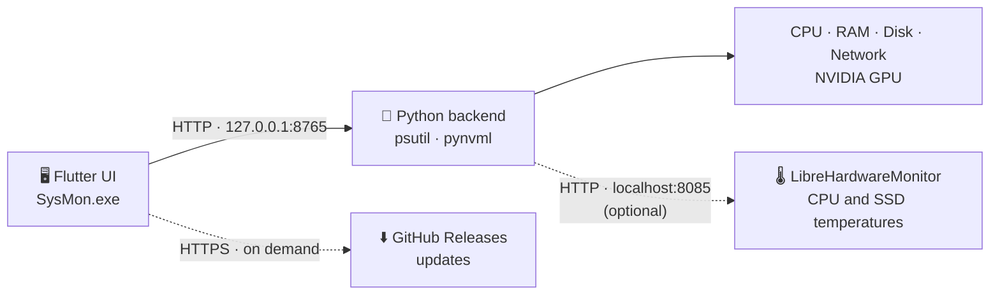

<div align="center">

# 🖥️ SysMon

**A lightweight, real-time system monitor for Windows — CPU, GPU, RAM, network and temperatures in one clean dashboard.**

[](https://github.com/pourad/Sysmon/releases/latest)


[Features](#-features) · [How it works](#-how-it-works) · [Install](#-installation) · [Temperatures](#-temperatures) · [Updates](#-automatic-updates) · [Build](#-building-from-source) · [Troubleshooting](#-troubleshooting)

</div>

---

## 📖 Overview

SysMon shows what your computer is doing **right now** and warns you when something goes wrong.

It started as a small Python/Tkinter script and was rebuilt with a **Flutter** interface, so the look and feel can be redesigned freely. The part that reads the hardware stays in **Python** (`psutil`, `pynvml`), because a UI framework cannot read CPU/GPU counters on its own.

**What you get**

- Live charts and gauges for CPU, GPU, RAM and network
- Temperature tracking for **CPU, GPU and SSD** with min / average / max
- Alerts when usage crosses your thresholds, plus a log file for later review
- A process watcher that tells you when an app closes or crashes
- Light and dark themes
- One-click updates straight from GitHub Releases

<!--
📸 Screenshots — add images to docs/screenshots/ and uncomment this block.

| Dashboard | Temperatures |
|:--:|:--:|
|  |  |
| **Settings** | **Light theme** |
|  |  |
-->

---

## ✨ Features

### Pages

| Page | What it shows |
|---|---|
| **Dashboard** | Live CPU / GPU / RAM charts with current values, three gauges, quick stats (CPU frequency, GPU temperature, RAM used, disk write speed) and the process watcher |
| **CPU** | Usage gauge, 1-minute average, frequency, logical and physical cores, process count, a usage bar for every core, history chart |
| **GPU** | Usage, temperature, memory used / total, fan speed, history chart (NVIDIA GPUs) |
| **RAM** | Usage, total / used / available memory, swap, history chart, and the top processes by memory |
| **Network** | Download and upload speed (Mbps), history, total data transferred, active interface, packet counters |
| **Temps** | CPU, GPU and SSD temperature with **MIN / AVG / MAX**, colour-coded status, history chart and a reset button |
| **Log** | Live event log (alerts, warnings, crashes). Open the log file or clear the view |
| **Settings** | Alert thresholds, logging thresholds, cooldown, refresh interval, reset to defaults, and update check |

### Highlights

- **Smart alerts** — a banner appears when CPU, RAM or GPU reaches the critical level. A cooldown prevents alert spam.
- **Process watcher** — type a process name or PID. If it disappears, SysMon shows a crash alert and records it.
- **Colour-coded values** — green, yellow and red follow your thresholds everywhere (gauges, bars, temperatures).
- **Light / dark mode** — switch with the button at the bottom of the sidebar.
- **Reset to defaults** — with a confirmation dialog, so settings are never reset by accident.
- **Offline indicator** — the dashboard shows `● Live` or `● Offline` so you always know whether data is arriving.

---

## ⚙️ How it works

SysMon is two programs that talk over a local connection. Nothing is sent to the internet except the optional update check.



**The cycle**

1. Every second (configurable) the UI asks the backend for fresh numbers.
2. The backend reads the hardware and replies with a single JSON document.
3. The UI updates its charts, checks the alert thresholds and records events.
4. Events that matter are also written to a log file through the backend.

In the installed version you never start the backend yourself — the app launches it automatically and the backend closes by itself when the app closes.

<details>
<summary><b>Backend API</b> (for developers)</summary>

The backend listens on `127.0.0.1:8765`.

| Method | Path | Purpose |
|---|---|---|
| `GET` | `/stats` | All system statistics as JSON |
| `GET` | `/top-procs` | The six processes using the most memory |
| `GET` | `/health` | Simple "is it running" check |
| `POST` | `/watch` | Start watching a process — body `{"query": "chrome"}` or a PID |
| `POST` | `/unwatch` | Stop watching |
| `POST` | `/log` | Append a line to the log file — body `{"msg": "..."}` |
| `POST` | `/open-log` | Open the log file with the default editor |

</details>

---

## 🌡️ Temperatures

Windows does not give ordinary programs direct access to CPU and SSD sensors, so SysMon reads temperatures from the best available source:

| Component | Source | Needs extra software? |
|---|---|---|
| **GPU** | NVIDIA driver (NVML) via `pynvml` | No |
| **CPU** and **SSD** | [LibreHardwareMonitor](https://github.com/LibreHardwareMonitor/LibreHardwareMonitor) web server | Yes — bundled with the installer |
| Any (Linux) | `psutil` sensors | No |

**Good to know**

- Reading CPU temperature needs **Administrator** rights, so the installed app asks for one Windows confirmation each time it starts.
- If a sensor is not available, its card shows `N/A` and the page explains how to enable it.
- With several SSDs, the hottest one is shown.
- **MIN / AVG / MAX** are calculated from the moment the app starts (or from the last reset).
- Colour limits (warning / critical) can be changed in `lib/config.dart` → `kTempLimits`.

| Component | Warning | Critical |
|---|---|---|
| CPU | 75 °C | 90 °C |
| GPU | 75 °C | 85 °C |
| SSD | 55 °C | 70 °C |

---

## 🔔 Alerts and logging

**Default thresholds** (all adjustable in **Settings**):

| Setting | Default |
|---|---|
| CPU warning / critical | 70 % / 85 % |
| RAM warning / critical | 70 % / 85 % |
| GPU warning / critical | 70 % / 85 % |
| Write to log when CPU or GPU is above | 80 % |
| Alert cooldown | 30 s |
| Refresh interval | 1 s |

**Log file**

- Installed version: `%LOCALAPPDATA%\SysMon\monitor_log.txt`
- Running from source: `monitor_log.txt` next to `monitor_backend.py`

Lines are tagged so they are easy to search:

| Tag | Meaning |
|---|---|
| `[INFO]` | Start, stop, bundled tools |
| `[ALERT]` | A critical threshold was crossed |
| `[PRESSURE]` | Usage or GPU temperature stayed above the logging level |
| `[WATCH]` | Process watcher started or stopped |
| `[CRASH]` | A watched process closed |
| `[SETTINGS]` | Settings were applied or reset |

> Settings and the chosen theme are kept while the app is open. They return to the defaults after a restart.

---

## 📥 Installation

### For users

1. Open the [**Releases**](https://github.com/pourad/Sysmon/releases/latest) page.
2. Download **`SysMon-Setup.exe`** and run it.
3. Start **SysMon** from the Start menu or the desktop shortcut.
4. Accept the Windows confirmation (Administrator) so CPU and SSD temperatures can be read.

No Python, no terminal, and no other downloads are needed.

> Windows SmartScreen may show an "Unknown publisher" warning because the installer is not digitally signed. Choose **More info → Run anyway**.

### Requirements

- Windows 10 or 11 (64-bit)
- An NVIDIA GPU is optional — it only enables GPU usage and temperature

---

## 🔄 Automatic updates

Open **Settings → Updates → Check for updates**.

1. SysMon asks GitHub for the latest release of this repository.
2. If the version is newer, you see the release notes.
3. **Download & install** downloads the installer with a progress bar.
4. SysMon checks the file size (and the SHA-256 checksum when GitHub provides one), then starts the installer.
5. The installer closes SysMon, replaces the files and starts the new version.

Only files from this repository are accepted.

<details>
<summary><b>Publishing an update</b> (for the maintainer)</summary>

1. Raise the version number in three places: `kAppVersion` (`lib/config.dart`), `version:` (`pubspec.yaml`) and `AppVersion` (`installer.iss`).
2. Run `build_release.bat`, then compile `installer.iss` with Inno Setup to get `SysMon-Setup.exe`.
3. On GitHub choose **Releases → Draft a new release**.
4. Create a tag such as `v1.1.0` (it must be higher than the previous one).
5. Attach `SysMon-Setup.exe` and describe the changes — users see this text in the app.
6. Leave **Pre-release** unchecked and press **Publish release**.

Never change the `AppId` in `installer.iss`; it is what lets a new version replace the old one.

</details>

---

## 🛠️ Building from source

<details>
<summary><b>Run in development mode</b></summary>

**Requirements:** [Flutter SDK](https://docs.flutter.dev/get-started/install) (with Visual Studio "Desktop development with C++") and Python 3.

```bash
# 1) Backend — keep this terminal open
cd backend
pip install psutil pynvml
python monitor_backend.py

# 2) UI — in a second terminal, from the project root
flutter pub get
flutter run -d windows
```

While the app is running, press `r` in the Flutter terminal (or save the file in VS Code) to see UI changes instantly with **Hot Reload**.

For CPU and SSD temperatures, run LibreHardwareMonitor as Administrator and enable **Options → Remote Web Server → Run**.

</details>

<details>
<summary><b>Build the installer</b></summary>

1. (Optional) Put LibreHardwareMonitor in a folder named `lhm` next to `pubspec.yaml`, with its `LibreHardwareMonitor.config` set to run the web server.
2. Run `build_release.bat` — it packages the backend with PyInstaller, builds the Flutter app and gathers everything in `build\windows\x64\runner\Release`.
3. Open `installer.iss` in [Inno Setup](https://jrsoftware.org/isinfo.php) and press **Compile**. The result is `Output\SysMon-Setup.exe`.

See [`BUILD.md`](BUILD.md) for the full guide, including the Administrator manifest.

</details>

---

## 🎛️ Customising

| I want to change… | Where |
|---|---|
| Colours (dark and light) | `lib/config.dart` → `AppColors` |
| Text sizes and styles | `lib/config.dart` → `AppText` |
| Temperature colour limits | `lib/config.dart` → `kTempLimits` |
| The GitHub repository used for updates | `lib/config.dart` → `kGithubRepo` |
| The look of every button | `lib/widgets/common.dart` → `AppButton` |
| The layout of one page | its file in `lib/pages/` |
| How temperatures are read | `backend/monitor_backend.py` → `TempReader` |

---

## 🗂️ Project structure

```
sysmon/
├── backend/
│   └── monitor_backend.py      Hardware reader + local HTTP server (no GUI)
├── lib/
│   ├── main.dart               App start, sidebar, alert banner
│   ├── config.dart             Colours, text styles, defaults, version, repo
│   ├── controller.dart         App logic: polling, alerts, log, process watcher
│   ├── stats.dart              Data model for the backend's JSON
│   ├── api.dart                Talks to the backend
│   ├── temp_tracker.dart       Temperature min / avg / max tracking
│   ├── updater.dart            GitHub release check, download and install
│   ├── backend_launcher.dart   Starts the backend in the installed app
│   ├── widgets/                Reusable UI pieces (cards, buttons, gauge, charts)
│   └── pages/                  One file per page
├── build_release.bat           Builds the app and backend
├── installer.iss               Inno Setup installer script
└── BUILD.md                    Packaging and publishing guide
```

---

## 🩺 Troubleshooting

| Problem | Likely cause and fix |
|---|---|
| Dashboard shows **● Offline** | The backend is not running. In development, start `monitor_backend.py`. |
| GPU values stay at 0 | No NVIDIA GPU, or `pynvml` is missing (`pip install pynvml`). |
| CPU or SSD temperature shows **N/A** | LibreHardwareMonitor is not running as Administrator, or its Remote Web Server is off. |
| Update check says **No release found** | The repository must be public and the release must be published (not a draft or pre-release). |
| Update check fails with a connection error | GitHub is unreachable — check your internet connection, VPN or proxy. |
| Windows warns about an unknown publisher | The installer is unsigned. Use **More info → Run anyway**. |
| Antivirus flags the app | Packaged Python programs are sometimes flagged by mistake. Add an exception or report it as a false positive. |

---

## 🧭 Ideas for the future

- Remember settings and theme between launches
- Temperature alerts with the same banner used for CPU and RAM
- A single native helper to read sensors directly, replacing the Python backend and the separate LibreHardwareMonitor window
- Support for AMD and Intel GPU usage

---

## 🙏 Credits

- [Flutter](https://flutter.dev) — user interface
- [psutil](https://github.com/giampaolo/psutil) — CPU, memory, disk and network data
- [pynvml / nvidia-ml-py](https://pypi.org/project/nvidia-ml-py/) — NVIDIA GPU data
- [LibreHardwareMonitor](https://github.com/LibreHardwareMonitor/LibreHardwareMonitor) — CPU and SSD temperatures (MPL-2.0)
- [Inno Setup](https://jrsoftware.org/isinfo.php) — installer

## 📄 License

Add your license here (for example MIT) and place a `LICENSE` file in the repository root.

<div align="center">

Made with Flutter and Python · Feedback and ideas are welcome via [Issues](https://github.com/pourad/Sysmon/issues)

</div>
